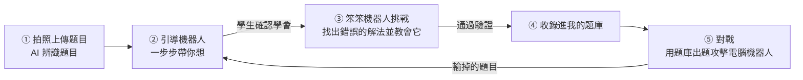
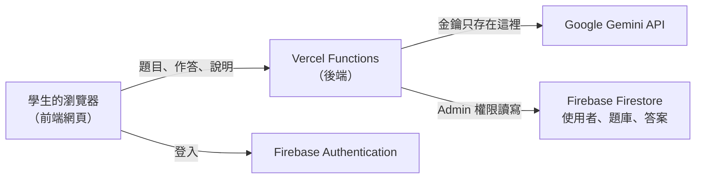

# TeachBot Arena 教會笨笨大作戰

**拍題目、學會它、教會笨笨機器人，再用學會的題目和對手對戰的國小數學 AI 學習遊戲**

115-1 南大 AI 課程 小組專題計畫書

> **一句話介紹**：不會的題目拍下來，AI 陪你一步步想通；教會「笨笨機器人」之後，這題就變成你的技能，可以拿去和對手的機器人對戰。學得越多、越難，你的機器人就越強。

---

## 目錄

1. [背景與動機](#1-背景與動機)
2. [專題目標](#2-專題目標)
3. [系統流程](#3-系統流程)
4. [模組說明](#4-模組說明)
5. [對戰規則](#5-對戰規則暫定)
6. [實作範圍](#6-實作範圍)
7. [技術架構](#7-技術架構)
8. [使用的免費方案](#8-使用的免費方案)
9. [預期成效與評估方式](#9-預期成效與評估方式暫定)
10. [個資與資料保護](#10-個資與資料保護)
11. [時程規劃](#11-時程規劃共-3-週)
12. [組員分工](#12-組員分工)
13. [資料夾結構](#13-資料夾結構規劃)
14. [協作方式](#14-協作方式)
15. [參考文獻](#15-參考文獻引用前請再核對原文)

---

## 1. 背景與動機

- 現在的 AI 工具大多是「解答機」，孩子丟題目進去就拿到答案，跳過了思考。
- 孩子寫作業遇到不會的題目，常常只是抄答案，沒有真的弄懂，下次遇到一樣不會。
- 我們想打造一個**不直接給答案、會一步步帶思考、還要孩子當小老師教回去**的學習夥伴，並用**對戰遊戲**讓孩子主動想學更多、更難的題目。

## 2. 專題目標

1. **培養獨立思考**：AI 不直接給答案，而是一步一步提問，陪孩子拆解題意。
2. **確認真的學會**：孩子要從笨笨機器人的兩種解法中找出錯誤的迷思概念，並說明為什麼錯，才算學會。
3. **提高主動練習的動機**：學會的題目會變成對戰用的「技能」，學越多、越難的題目，在對戰中越有優勢。

## 3. 系統流程



**學習循環**：對戰時答錯的題目，可以帶回 ② 用引導機器人學會，再收進自己的題庫，變成自己的技能。

## 4. 模組說明

### ① 題目掃描（負責：呂○蓁）

- **功能**：學生拍照或上傳題目圖片，AI 辨識成文字，學生確認或修正文字後送出。
- **AI 會同時判斷**：年級、單元、難度（1～3 星），並列出**算式與答案**。
- **答案驗算**：程式會自己算一次 AI 給的算式，和 AI 的答案一致才繼續，降低 AI 算錯的風險。
- **適用題目**：國小數學中「答案是一個數字」的題目（整數、小數、分數），不限單元。作圖題、多個答案的題目，AI 會請學生換一題。
- **個資保護**：提醒學生只拍題目，不要拍到姓名；圖片辨識完就丟棄，不保存。

### ② 引導機器人（負責：呂○蓁）

- **功能**：一次只給一個引導問題或關鍵字，陪孩子拆解題意，直到孩子自己算出答案。
- **設計重點**：
  - 拒絕直接給答案。
  - 孩子連續卡關時，提供「示範一步」的出口，避免挫折感累積。
  - 孩子算出正確答案、按下「我學會了」之後，才交給笨笨機器人。
- **理論依據**：Vygotsky 近側發展區（ZPD）、鷹架理論、蘇格拉底式提問。

### ③ 笨笨機器人挑戰（負責：張○誠）

- **功能**：笨笨機器人針對剛學會的題目，提出 **A、B 兩種解法**，其中一個藏著常見的迷思概念。
- **通過條件**（兩關都要過）：
  1. 學生**選出有迷思概念的那一個解法**：對錯由程式判斷（產生解法時就記錄哪一個是錯的）。
  2. 學生**說明為什麼錯**：由 AI 依評分標準判斷，例如有沒有指出錯誤的關鍵。
- **沒通過時**：笨笨機器人會追問或給提示，最多三次，不讓孩子卡死。
- **通過後**：這一題收錄到學生的題庫。收錄由後端執行，學生無法自己偽造。
- **理論依據**：以教促學（learning by teaching）、可教代理人（teachable agent）、錯例學習（erroneous examples）。

> **關於創新點**：「對戰時互相出題扣血」已經有美國專利前案，所以對戰機制本身不是創新點。本專題的差異在於**題庫必須靠「教會笨笨機器人」才能取得**，對戰實力等於真正學會的題目。詳見 [docs/文獻與專利.md](docs/文獻與專利.md)。

### ④ 我的題庫（負責：張○誠）

- 每一題都會記錄題目文字、年級、單元、難度。
- **答案另外存放，只有後端讀得到**。

### ⑤ 對戰（畫面：余○靜；規則：張○誠）

- 第一版是學生的機器人**對戰電腦機器人**；同班真人連線列為未來擴充（見第 6 節）。
- 學生用自己的題庫出題攻擊電腦，電腦用預設的電腦題庫出題攻擊學生。
- 機器人暱稱與造型從預設選項中挑選，不開放自由輸入。
- **理論依據**：遊戲式學習（game-based learning）、競爭式遊戲化；學生用學會的題目考對手，也是一種學生出題（student-generated questions）活動。

## 5. 對戰規則（暫定）

| 項目 | 規則 |
| --- | --- |
| 開戰條件 | 題庫至少 3 題 |
| 血量 | 學生和電腦各 5 滴血 |
| 回合 | 學生出題 → 電腦作答 → 電腦出題 → 學生作答，輪流進行 |
| 學生出題 | 30 秒內從自己的題庫選一題；同一場同一題只能用一次 |
| 電腦作答 | 依題目難度用機率決定答對或答錯：★ 答對率 70%、★★ 50%、★★★ 30% |
| 學生解題時間 | 依難度：★ 60 秒、★★ 90 秒、★★★ 120 秒 |
| 扣血 | **答錯或超時扣 1 滴血**，答對不扣血；不論難度都是扣 1 滴 |
| 勝負 | 先歸零的一方輸；10 回合後還沒分出勝負，血多的一方贏，同血平手 |
| 難題的優勢 | 難題扣的血一樣多，但電腦比較可能答錯，所以比較容易讓對方扣血 |

**電腦題庫**：由組員準備 15 題示範題目（★、★★、★★★ 各 5 題），答案只存在後端，學生作答時由後端比對。

## 6. 實作範圍

**第一版（期末完成，共 3 週）**

| 項目 | 內容 |
| --- | --- |
| 學習流程 | 掃描 → 引導 → 笨笨機器人 → 收錄題庫 |
| 對戰 | 對電腦機器人 |
| 帳號 | 老師發「代號＋密碼」（Firebase Authentication） |
| 題目範圍 | 國小數學、答案是一個數字的題目，不限單元 |
| 試用對象 | 高年級一個班，小規模試用 |
| 說明方式 | 文字輸入 |

**未來擴充**

| 項目 | 說明 |
| --- | --- |
| 同班連線對戰 | 用房間碼配對兩位同學。已預留設計（見第 7 節），主要是新增「對戰房間」資料與後端判定，預估 3～5 天 |
| 表情貼圖、斷線判定 | 連線對戰的配套功能 |
| 批次建立帳號 | 第一版由老師在後台手動建立帳號 |
| 笨笨出「同類型的新題目」 | 確認學生真的學會，而不是記住答案 |
| 語音說明 | 瀏覽器內建 Web Speech API |
| 角色動畫、3D 對戰特效 | 精靈圖動畫、00GameDevs 特效 |
| 作圖題、多答案題 | 需要另外設計比對方式 |

## 7. 技術架構



| 層級 | 使用技術 | 說明 |
| --- | --- | --- |
| 前端 | HTML、CSS、JavaScript（原生） | 不使用大型框架，平板與電腦都能開 |
| 後端 | Vercel Functions | 呼叫 AI、驗算答案、收錄題目、比對對戰答案，保護金鑰 |
| 帳號 | Firebase Authentication | 老師發「代號＋密碼」，學生登入 |
| 資料庫 | Firebase Firestore | 使用者、題庫、答案、題目草稿；資料位置選台灣（`asia-east1`） |
| AI | Google Gemini API | 辨識題目、引導機器人、笨笨機器人、評判學生說明 |
| 部署 | Vercel（連結本 GitHub 儲存庫） | 推送程式後自動更新網站；每個 Pull Request 會有預覽網址 |

### 為了未來擴充而預留的設計

這四點現在就照著做，以後加上連線對戰或換後端時，前端幾乎不用改：

1. **前端只透過 `public/js/api.js` 呼叫後端**：所有請求集中在這個檔案（例如 `api.login()`、`api.saveQuestion()`、`api.checkAnswer()`），其他畫面不直接寫網址。
2. **資料格式固定用「題目卡 JSON」**：欄位名稱以 [合作分工表第七節](docs/合作分工表.md#七介面約定第一週前-3-天定案) 為準。
3. **對戰規則寫成獨立的 `public/js/battle-rules.js`**：輸入「目前狀態＋這一步動作」，輸出「新的狀態」，不直接操作畫面。以後連線時，同一份規則可以搬到後端當裁判。
4. **對電腦對戰也用「對戰狀態」物件記錄**：格式和未來連線用的房間資料相同（血量、輪到誰、階段、倒數時間），以後只要把「電腦」換成「另一位同學」。

### 帳號方式

- 老師在 Firebase 後台建立學生帳號，帳號用代號組成（例如 `50101@teachbot.example`，格式待測試），密碼由老師發給學生。
- 學生忘記密碼時，由老師在後台重設。

### API 金鑰與用量控管

- **Gemini 金鑰由張○誠申請，只放在 Vercel 後台**。學生不需要、也不會看到任何金鑰。
- 全班共用同一個免費額度，所以後端會限制**每位學生每天呼叫 AI 的次數**（`AI_DAILY_LIMIT_PER_STUDENT`，暫定 50 次），避免少數人把額度用完。
- 組員在本機開發時，各自用自己申請的免費金鑰。

### 資料庫安全規則（Firestore Security Rules）重點

- 所有讀取都必須先登入（`request.auth != null`）。
- 學生只能讀自己的使用者資料與題庫。
- 題庫、答案、草稿**前端一律不能寫入**，只能透過後端寫入。
- 答案與草稿前端完全不能讀取。
- 前端查詢一律加 `limit()`，避免一次讀取整個資料表。

### 金鑰安全

- 本儲存庫是公開的，**Gemini 金鑰與 Firebase 服務帳戶金鑰不可寫在程式碼或前端網頁裡**。
- 金鑰設定在 Vercel 後台的環境變數；本機測試時放在 `.env`（已列入 `.gitignore`），變數名稱請見 [.env.example](.env.example)。
- Firebase 的「網頁設定（Web Config）」本來就是公開資訊，可以放在前端，但一定要搭配上面的安全規則。

## 8. 使用的免費方案

| 服務 | 方案 | 用途 | 要注意的限制 |
| --- | --- | --- | --- |
| GitHub | Free（公開儲存庫） | 程式碼、Issues、Pull Request、Projects 看板 | 公開儲存庫任何人都看得到，不能放金鑰與個資 |
| Vercel | Hobby | 網站、後端函式、PR 預覽網址 | 限非商業用途；函式的數量、執行時間與次數有上限 |
| Firebase | Spark | 帳號、題庫 | 每天的讀寫次數有上限；沒有綁信用卡，額度用完會暫停服務，不會被收費 |
| Gemini API | Google AI Studio 免費額度 | 辨識題目、兩個機器人、評判說明 | 每分鐘與每天的次數有限，全班同時使用可能會超過；免費方案送出的內容可能被 Google 用來改善服務，所以**不能送出任何個資** |
| AI 開發工具 | 依組員個人方案 | Claude Code、Antigravity、ChatGPT／Codex | 各工具的免費額度不同，由組員自行確認 |

> 各服務的免費額度會變動，正式試用前請再到官方網站確認。若日後升級成付費方案，要先在後台設定預算上限，以及 50%、80%、100% 的用量通知。

## 9. 預期成效與評估方式（暫定）

| 研究問題 | 評估方式 |
| --- | --- |
| RQ1：使用系統後，學生的解題正確率是否提升？ | 前後測 |
| RQ2：學生辨識迷思概念的能力是否提升？ | 笨笨機器人挑戰的通過率、說明內容的品質 |
| RQ3：對戰機制是否提高學生主動練習的意願？ | 題庫題數、主動上傳題目的次數、學習動機問卷 |

> 時程只有 3 週，期末先以小規模試用與系統展示為主；完整的前後測可以在下學期進行。

## 10. 個資與資料保護

- 學生一律使用**代號**（班級代號＋座號，例如 50101），不蒐集姓名；畫面上只顯示代號與機器人暱稱。
- 只蒐集達成目的的最少資料：代號、題庫、AI 使用次數。對戰過程不保存。
- 上傳的題目圖片辨識完即丟棄，不保存。
- **保存期限**：題庫在學期末清除；學生帳號在試用結束後刪除。
- Gemini 與 Firebase 都是國外服務，屬於資料委外處理；到班試用前，會先向學校資安窗口報備，並取得家長同意。

## 11. 時程規劃（共 3 週）

| 週次 | 目標 | 主要工作 |
| --- | --- | --- |
| 第 1 週 | **每個模組各自做得出來** | 前 3 天：建立環境、定案介面約定、畫面與角色草圖。後 4 天：掃描、引導、笨笨機器人、UI 各自完成（先用假資料） |
| 第 2 週 | **完整流程串起來** | 前半週：串接單人流程（登入 → 掃描 → 引導 → 笨笨 → 題庫）。後半週：對電腦對戰 |
| 第 3 週 | **緩衝與成果** | 修正錯誤、小規模試用、準備期末報告；有空才加對戰特效 |

## 12. 組員分工

| 組員 | 開發工具 | 負責項目 |
| --- | --- | --- |
| 張○誠 | Claude Code | ③ 笨笨機器人、④ 題庫、帳號、對戰規則、後端共用程式、部署、系統整合 |
| 呂○蓁 | Antigravity | ① 題目掃描、② 引導機器人、電腦題庫的 15 題示範題目 |
| 余○靜 | ChatGPT、Codex（美術輔助：Hugging Face Spaces、00GameDevs 特效庫） | 全站 UI、機器人美術、⑤ 對戰畫面 |

詳細的操作步驟與 GitHub 協作流程，請見 [docs/合作分工表.md](docs/合作分工表.md)。

## 13. 資料夾結構（規劃）

```
team-work/
├── public/                  前端網頁
│   ├── index.html           登入與首頁（余）
│   ├── css/                 樣式（余）
│   ├── assets/              機器人與介面美術素材、CREDITS.md 素材來源紀錄（余）
│   ├── vendor/vfx/          對戰特效（00GameDevs，第 3 週有空才加，余）
│   └── js/
│       ├── api.js           前端呼叫後端的唯一入口（張）
│       ├── battle-rules.js  對戰規則（張）
│       ├── firebase-config.js   Firebase 公開設定（張）
│       ├── mock-data.js     前端假資料（張）
│       ├── ui/              共用畫面元件（余）
│       ├── scan.js          題目掃描畫面（呂）
│       ├── tutor.js         引導機器人畫面（呂）
│       ├── dumbbot.js       笨笨機器人畫面（張）
│       └── battle.js        對戰畫面（余）
├── api/                     Vercel Functions 後端
│   ├── _lib/                共用程式：呼叫 Gemini、連線 Firebase、驗算、用量限制（張）
│   ├── _data/               電腦題庫（呂準備題目、張接上後端）
│   ├── problem.js           題目辨識與確認（呂）
│   ├── tutor.js             引導機器人（呂）
│   ├── dumbbot.js           笨笨機器人與收錄題庫（張）
│   └── battle.js            電腦出題、比對學生答案（張）
├── prompts/                 各機器人的提示詞（依模組負責人）
├── firestore.rules          資料庫安全規則（張）
├── docs/                    文件、會議紀錄、分工表、文獻
├── AGENTS.md                給 AI 開發工具看的共同規則（Codex 會自動讀取）
├── CLAUDE.md                讓 Claude Code 讀取 AGENTS.md
├── .env.example             環境變數範本（複製成 .env 後自行填寫）
├── .gitignore               不上傳到 GitHub 的檔案清單
└── README.md                專題計畫書（就是這份）
```

> `api/_lib/`、`api/_data/` 開頭是底線，Vercel 不會把它們當成對外的網址。但因為儲存庫是公開的，電腦題庫在 GitHub 上看得到，所以只放**示範用題目**，不要放正式測驗題。

## 14. 協作方式

- `main` 分支只放穩定、可以展示的版本，**不直接修改 `main`**。
- 每個功能開一個分支 → 推上 GitHub → 開 Pull Request → 至少一位組員看過再合併。
- 每人負責自己的資料夾，要改別人的檔案先在群組說一聲。
- 提交前先 `git status`，確認沒有 `.env` 或金鑰檔。
- commit 訊息用中文簡短寫清楚「改了什麼」，例如：`新增題目拍照上傳畫面`。
- 本儲存庫為公開（Public），**不可放入金鑰、密碼或學生個資**。

完整步驟請見 [docs/合作分工表.md](docs/合作分工表.md)。

## 15. 參考文獻（引用前請再核對原文）

> 近五年 SSCI 論文與相關專利整理，請見 [docs/文獻與專利.md](docs/文獻與專利.md)。

**經典理論文獻**

- Adams, D. M., et al. (2014). Using erroneous examples to improve mathematics learning with a web-based tutoring system. *Computers in Human Behavior, 36*, 401–411.
- Biswas, G., Leelawong, K., Schwartz, D., Vye, N., & TAG-V. (2005). Learning by teaching: A new agent paradigm for educational software. *Applied Artificial Intelligence, 19*(3–4), 363–392.
- Chase, C. C., Chin, D. B., Oppezzo, M. A., & Schwartz, D. L. (2009). Teachable agents and the protégé effect: Increasing the effort towards learning. *Journal of Science Education and Technology, 18*(4), 334–352.
- Jagušt, T., Botički, I., & So, H.-J. (2018). Examining competitive, collaborative and adaptive gamification in young learners' math learning. *Computers & Education, 125*, 444–457.
- Pareto, L., Haake, M., Lindström, P., Sjödén, B., & Gulz, A. (2012). A teachable-agent-based game affording collaboration and competition: Evaluating math comprehension and motivation. *Educational Technology Research and Development, 60*(5), 723–751.
- Plass, J. L., O'Keefe, P. A., Homer, B. D., Case, J., Hayward, E. O., Stein, M., & Perlin, K. (2013). The impact of individual, competitive, and collaborative mathematics game play on learning, performance, and motivation. *Journal of Educational Psychology, 105*(4), 1050–1066.
- Große, C. S., & Renkl, A. (2007). Finding and fixing errors in worked examples: Can this foster learning outcomes? *Learning and Instruction, 17*(6), 612–634.
- Plass, J. L., Homer, B. D., & Kinzer, C. K. (2015). Foundations of game-based learning. *Educational Psychologist, 50*(4), 258–283.
- Vygotsky, L. S. (1978). *Mind in society: The development of higher psychological processes*. Harvard University Press.
- Wood, D., Bruner, J. S., & Ross, G. (1976). The role of tutoring in problem solving. *Journal of Child Psychology and Psychiatry, 17*(2), 89–100.
